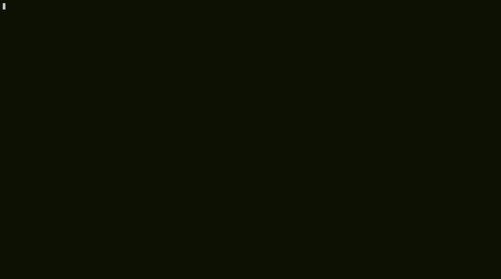

<p align="center">
  <a href="https://doi.org/10.5281/zenodo.21418626"></a>
   <br>
  
</p>

### Simple Interface MIAPPE-Phis, Lightweight & Efficient

  V see here for a Quick Demo ! V (click to zoom in)



or here : [asciinema link](https://asciinema.org/a/vgznnODoenqWjDki)

## Description.

In the context of my internship, I am working on SIMPLE, a Command Line Interface and a graphical interface coded in python with a focus on ease of use, rapidity and flexibility. This tool has been designed to help researchers upload MIAPPE compliant phenotyping data on OpenSilex Phis instances with minimal efforts : filling a MIAPPE template. Allowing them to keep germplasm banks up to date, create experiments, add scientific objects to an experiment, add pictures, tabular data and more !

All this with a thorough [documentation](https://anedelweiss.github.io/SIMPLE/) to make the process as easy as possible !

Dummy experiment on Phis Sandbox to show how the final experiment would look : [link to sandbox](https://opensilex.org/sandbox/app/experiment/details/opensilex-sandbox%3Aid%2Fexperiment%2Fdummy_experiment) (connect as guest)

## Instructions

Please follow the documentation available here : [WIP documentation](https://anedelweiss.github.io/SIMPLE/), this is the most complete way to learn how to use this program.

## Instructions for developers/contributors: 

This project requires Python 3.12+.

```bash
git clone https://github.com/AnEdelweiss/SIMPLE.git
cd SIMPLE
uv sync                # installs the project + dev/test tooling
uv run simple          # run the CLI
uv sync --extra gui    # adds PyQt6 (required for the GUI)
uv run simple --gui    # run the GUI
```

You can then use the provided dummy experiment, you can also modify the content of the miappe template to try and create different experiments, germplasms etc...
Everything should work !

link to opensilex project : [opensilex github](https://github.com/OpenSILEX/opensilex )

link to opensilex python package : [opensilex github](https://github.com/OpenSILEX/opensilexClientToolsPython )

## Offline check

`uv run simple --dry-run exp_database/dummy_experiment` validates an experiment folder (template sheets, referenced datafiles) without logging in or uploading anything. Exit code is 1 if something is missing.

## Custom instances

The built-in instance list can be extended or overridden without editing the
code. The default config file is `~/.config/simple/config.toml` (override it
with `SIMPLE_CONFIG`):

```toml
[instances]
"https://my-phis.example/rest" = "My PHIS"
"https://opensilex.org/sandbox/rest" = "Sandbox (local name)"
```

You can also add instances for a single run with `SIMPLE_INSTANCES`
(`Name=URL` pairs, comma-separated). Environment entries win over the TOML
file, which wins over the built-in list:

```bash
SIMPLE_INSTANCES="Lab PHIS=https://phis.lab.example/rest" uv run simple
```

The login menu always offers a `Custom URL` row, so a one-off instance does
not need any configuration at all.

## Contributing

This project can always be perfected, contribution are always welcome.
Don't hesitate to create an issue or a pull request, I will do my best to review/answer as soon as possible.
Forks and modifications are also welcome.

## Project roadmap :

- ~~Creating a 'troubleshooting/Q&A' section and a more thorough tutorial/doc :)~~
- ~~Make a logo for the program :p~~
- Automation(?)
- ~~Change factor/factor level fetching and measuring date/measuring time from tabular data.~~
- Generalization : ~~changing the hardcoded provenances and PID~~, create the output document properly (and the output folder in the experiment directory etc...)
- ~~Updating the blank miappe available in the github~~
- ~~refactoring :-(~~
- ~~Using the rich library.~~
- ~~English translation.~~
- ~~Photo upploadng.~~
- ~~Make a 'help' feature in the CLI~~
- ~~Data upploading.~~
- ~~Reading the image names from the tabular data file and comparing them to those found locally. Thus limiting the parsing data from filename and using directly the tabular data.~~
- ~~Generalization : no more 'fec' and 'fem' when importing images, 'do you want to import 1 or 2 sets of datafiles (one obtained from the first one)' ability to import more than just images (tar files, fluorescence data...)~~
- ~~Logging everything into a log-dd-mm-yyyy.log to keep a written trace of what has been done during the session.~~
