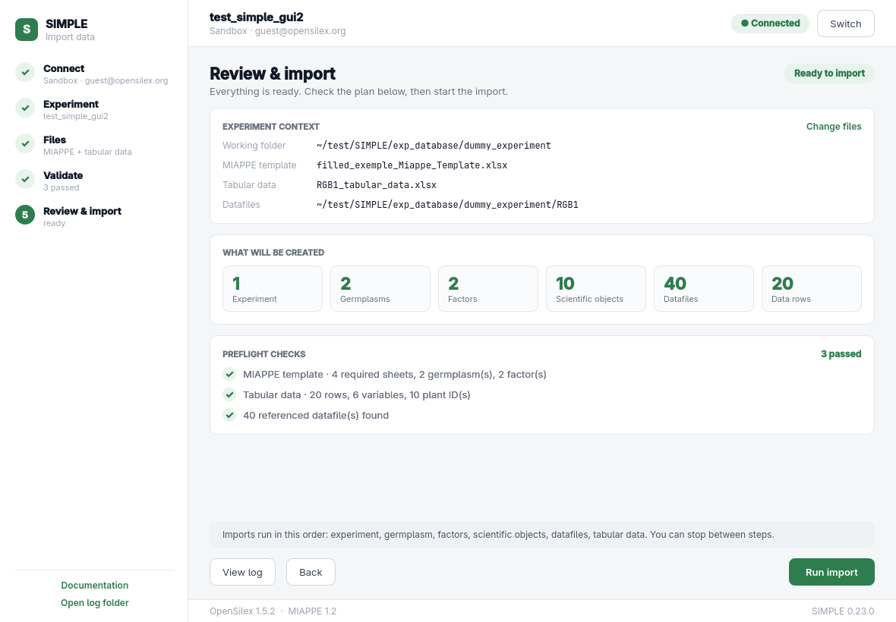
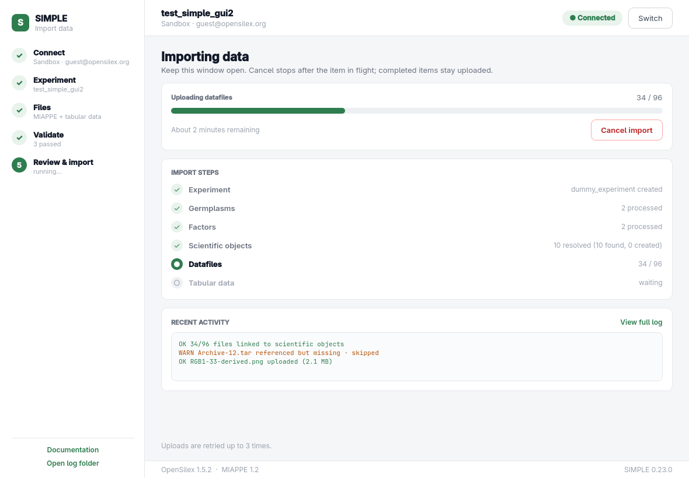

# Importing data with the GUI

The GUI follows the same import order as the CLI, but discovers the files for
you, checks them offline, and shows what will be uploaded before anything is
sent.

## Before you start

Fill the MIAPPE template, organise the experiment folder, and format the
tabular data:

- [Fill the MIAPPE template]()
- [Organise the experiment folder]()
- [Format the tabular data]()

## Launching the GUI

Download the release for your system from the
[releases page](https://github.com/AnEdelweiss/SIMPLE/releases) and open the
GUI application it contains:

- **Windows:** `SIMPLE-gui.exe` — double-click it.
- **Linux:** `SIMPLE-gui-linux` — allow it to run as a program if your system
  asks, then open it.

The same download also contains the command-line version (`SIMPLE.exe` or
`SIMPLE-linux`). Nothing else needs to be installed.

## Steps

### 1. Connect

Choose your instance in the list, or pick **Custom URL…** and paste the REST
URL. On the Sandbox the guest account is selected automatically. Your
identifier and password are only sent to that instance.

### 2. Choose the experiment folder

Pick the folder that contains the filled MIAPPE template, the tabular data and
the datafiles. SIMPLE looks inside and proposes:

- the MIAPPE template (`*miappe*.xlsx`),
- the tabular data (`*_tabular_data.xlsx`),
- the datafiles folder, chosen as the subfolder containing the files referenced
  by the tabular data.

If several candidates exist, pick the right one in the lists.

### 3. Confirm the files

Every path is visible on one screen and can be changed individually. Nothing
has to be reset to switch the MIAPPE template, the tabular data or the
datafiles.

### 4. Validate

SIMPLE checks the template and the files without logging in or uploading
anything:

- required MIAPPE sheets, columns and first-row values,
- readable tabular data and its row count,
- referenced datafiles present on disk.

Errors block the import. Warnings (for example a few missing datafiles) are
listed, and the affected items are skipped.

### 5. Review and import

The review screen shows the counts that will be created and the preflight
result. Press **Run import** to start.

The import runs in this order: experiment, germplasm, factors, scientific
objects, datafiles, tabular data. Each step is marked as it completes, and the
activity log shows the latest events.

## Cancelling an import

**Cancel import** stops after the item (or tabular batch) currently being
uploaded. Items already created stay on the instance; running the import again
is safe because existing items are found rather than duplicated.

## Logs

Use **View full log** in the import screen, or **Open log folder** in the
sidebar. The same log file is written by the CLI.

## Troubleshooting

Most errors come from typos in the MIAPPE file or from data that does not match
the template. Read the error shown on the Validate screen first, then the log.
See [troubleshooting]() for common cases.
